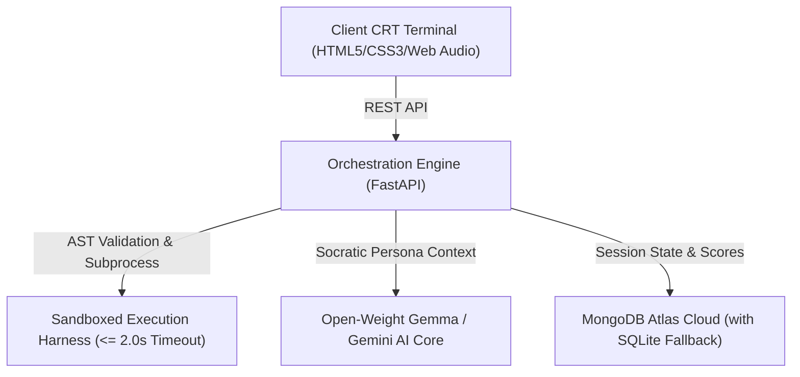

# QuestLearn: Shadows of the Machine — A Retro Socratic Coding RPG Powered by Open-Weight Gemma

*This is a submission for the [Hacktoberfest 2026 Open-Source AI Challenge](https://dev.to/challenges/hacktoberfest-2026): Week 4 — Ghost in the Machine.*

---

## 1. What I Built 🖥️👻

**QuestLearn: Shadows of the Machine** is an interactive, browser-based retro terminal role-playing game (RPG) designed to teach core computer science principles through narrative debugging and Socratic dialogue.

The game simulates **AetherOS**, an abandoned 1980s mainframe system infected by an autonomous execution daemon. To restore the operating system, learners must identify and repair broken Python algorithms across corrupted memory sectors. Along the way, the player communes with the digitized spirits of computer science pioneers (**Alan Turing**, **Grace Hopper**, and **Ada Lovelace**) who guide the learner with inquiry-based Socratic reasoning.

Powered by open-weight **Google Gemma** models, the AI core dynamically evaluates runtime errors and adapts puzzle difficulty in real time without ever providing verbatim code solutions.

---

## 2. Live Demo & Source Code 🔗

* **GitHub Repository:** [https://github.com/mrerror313coder/QuestLearn](https://github.com/mrerror313coder/QuestLearn)
* **License:** Apache 2.0 (Open Source)
* **Tech Stack:** Python 3.11+, FastAPI, Vanilla HTML5/CSS3 (CRT Shaders & Scanlines), Web Audio API (8-bit sound synthesizer), MongoDB Atlas + aiosqlite, Google Gemma (`gemma2-9b-it` / `gemini-2.5-flash`).

---

## 3. Theme Articulation: *Ghost in the Machine* & *Día de los Muertos* 🕯️

Our project directly interprets the Hacktoberfest Week 4 theme, *"Ghost in the Machine"*, by treating computational memory not as static silicon, but as an altar of memory:

1. **The Ghost as Adversary:** A corrupted autonomous daemon feeds on runaway recursion, boundary breaches, and symbol table ruptures, driving system integrity down to 25%.
2. **The Ghosts as Ancestral Mentors:** In the cultural tradition of **Día de los Muertos**, the player communes with the spirits of computing pioneers residing in the machine's legacy registers:
   * **Sector 0x01: The Recursive Void** — Guided by **Alan Turing** (*Recursion & Base Cases*). Turing reflects analytically on the Halting Problem and infinite tape descent.
   * **Sector 0x02: The Moth in the Relays** — Guided by **Grace Hopper** (*Array Bounds & Off-by-One Errors*). Hopper brings naval discipline, emphasizing physical relay limits and zero-based indexing.
   * **Sector 0x03: The Weaving Engine** — Guided by **Ada Lovelace** (*Dictionary Accumulation & Symbol Initializations*). Lovelace speaks poetically of the Analytical Engine weaving algebraic patterns like the Jacquard loom.

---

## 4. Why Open Innovation Matters for QuestLearn 💡

Traditional automated grading systems rely on passive unit tests or closed proprietary cloud APIs. In educational contexts, closed APIs create three severe vulnerabilities:
* **Student Data Harvesting:** Mistakes, code habits, and debugging histories are sent to third-party commercial training sets.
* **Prohibitive Paywalls & Rate Limits:** Students iterating rapidly on code face artificial token caps and credit card paywalls.
* **Lack of Offline Resiliency:** Classrooms in low-bandwidth regions cannot run cloud-tethered tutors.

### The Open-Source Solution
QuestLearn demonstrates the power of open-weight models (**Google Gemma**):
* **Data Sovereignty:** Student diagnostic histories stay localized or within a sovereign database instance.
* **Negative Prompting Policy:** The open-weight model is strictly tuned to act as a Socratic mentor. If asked *"give me the code"*, it politely refuses and poses a targeted question about algorithmic invariants.
* **Offline Resilience:** If network connectivity drops or no API key is supplied, QuestLearn's intelligent heuristic persona engine automatically kicks in, ensuring the learning experience never halts.

---

## 5. System Architecture ⚙️

QuestLearn is built on a four-tier architecture designed for sandbox isolation and deterministic safety:

### 1. Retro Presentation Layer
* Authentic Cathode Ray Tube (CRT) monitor aesthetic with scanlines, phosphor glow bloom, subtle screen flicker shaders, and switchable palettes (**Phosphor Green**, **Amber**, and **Cyber Cyan**).
* Keystroke-level Web Audio synthesizers generating typing clicks, modem chirps, and triumphant 8-bit victory arpeggios.
* Built-in in-terminal code patch editor modal supporting `Ctrl + Enter` execution.

### 2. AST-Isolated Execution Sandbox
* Python candidate patches undergo an Abstract Syntax Tree (AST) inspection to reject dangerous imports (`os`, `sys`, `subprocess`, `socket`) and primitives (`eval`, `exec`, `open`).
* Tested code is spawned in an isolated subprocess (`python -I`) with an enforced **2.0-second hard timeout** to neutralize infinite while-loops and runaway recursion.

### 3. Dual-Tier Persistence Layer
* **MongoDB Atlas Async Driver (`motor`):** Persists session integrity scores, attempt counters, and audit logs.
* **Transparent SQLite Fallback (`aiosqlite`):** Automatically engages if running offline or in restricted network environments, guaranteeing zero downtime.

---

## 6. How It Works (Player Journey) 🕹️

1. **Boot Sequence:** The learner arrives at `http://127.0.0.1:8000` encountering an unstable terminal reporting: `Memory Corruption: 75%`.
2. **Inspection (`scan`):** Typing `scan` reads the active sector, printing the buggy Python subroutine and the exact traceback.
3. **Spiritual Commune (`commune <question>`):** The learner asks the resident computing ancestor for guidance. The model analyzes the error logs and replies in-character with Socratic prompts.
4. **Code Patching (`patch` or `edit`):** The user writes their fix in the retro editor and applies it.
   * *If the test passes:* System integrity rises by 25%, the sector stabilizes, and the next memory block unlocks.
   * *If the test fails:* Traceback errors are logged, and the ancestor adapts their hints for the next attempt.
5. **System Exorcism (`report`):** Reaching 100% integrity dispels the daemon, allowing the player to download an official **AetherOS System Integrity & Mastery Exorcism Certificate (.txt)**.

---

## 7. Community Wisdom & Engineering Lessons 🧠

During development, critical engineering decisions were shaped by the broader developer community:

1. **Subprocess Sandboxing over In-Language `exec`:**
   Community vulnerability research confirms that attempting to sandbox Python within the interpreter via `__builtins__ = {}` is fundamentally insecure due to class hierarchy traversal (`__subclasses__`). True isolation requires OS process boundaries, `-I` isolated mode flags, and strict execution timeouts.
2. **Socratic AI Prompt Architecture:**
   Direct solution synthesis degrades learner retention. Crafting system prompts with explicit negative guardrails (*"Under no circumstances generate code blocks"*) ensures the model fulfills a genuinely pedagogical role.

---

## 8. What's Next 🔮

* **Additional Ancestor Sectors:** Introducing **Claude Shannon** (Boolean logic & bitwise masking) and **Margaret Hamilton** (asynchronous priority queues).
* **Multiplayer Mainframe Sprints:** Collaborative terminal sessions where pairs of students debug distributed race conditions in real time.

---

*Thank you to DEV, Hacktoberfest, and MLH for organizing this challenge. May the ghosts of our computing ancestors inspire the next generation of builders!*
